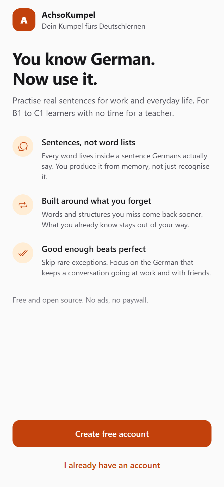
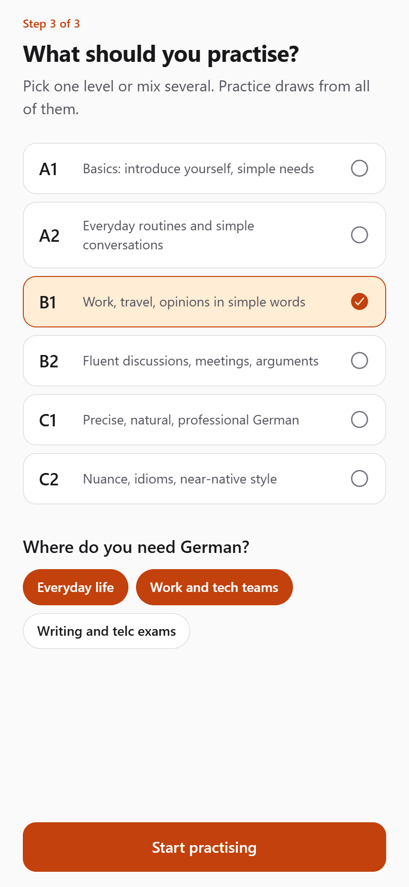
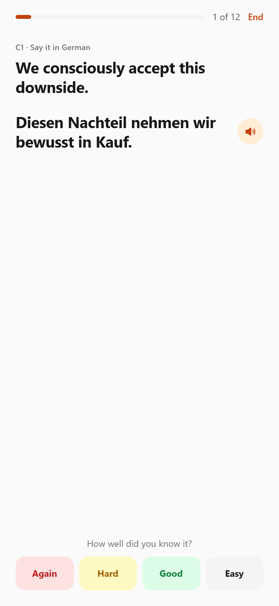
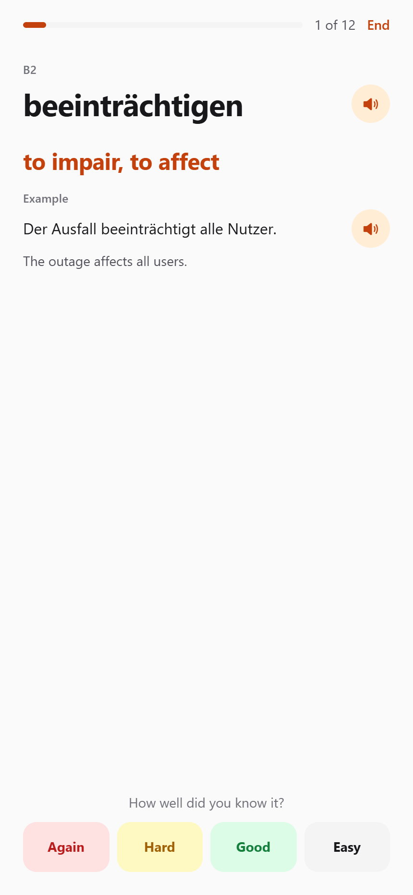
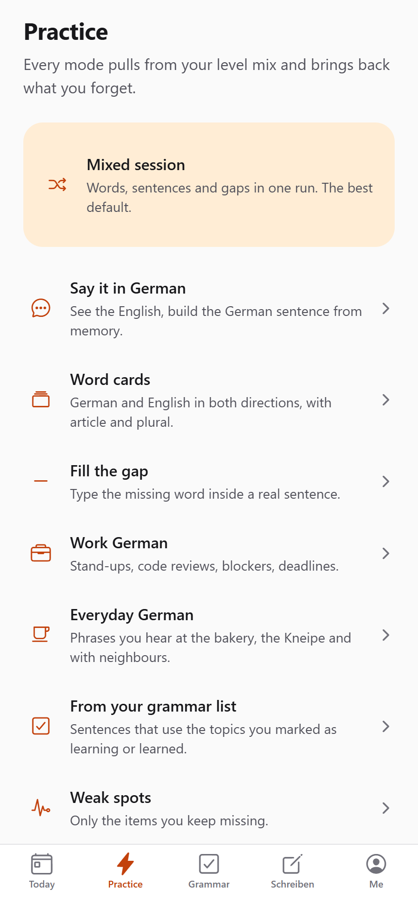
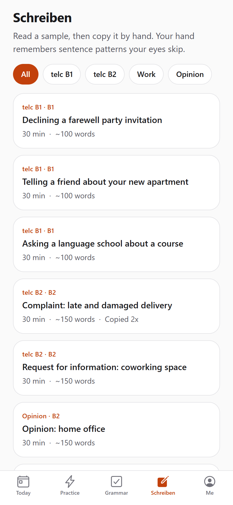
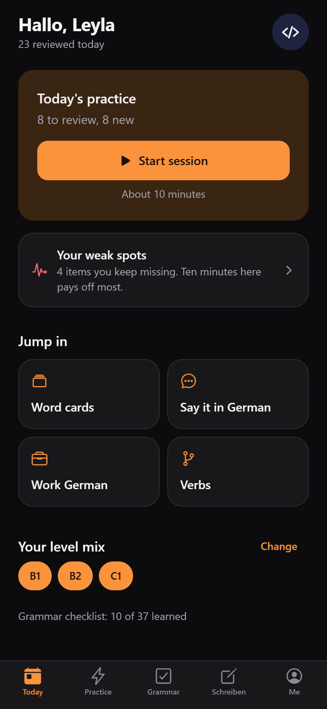

<div align="center">

# AchsoKumpel

**Dein Kumpel fürs Deutschlernen**

Turn the German you understand into German you can say.
Free, open source, no ads, no paywall.

[](LICENSE)


</div>

## Who it is for

You live or work in Germany. You reached B1, B2 or C1 at some point. You understand most of what your colleagues say, but in a stand-up or at the Kneipe the right word arrives three seconds too late. You have no time for a teacher.

AchsoKumpel is built for that gap:

- **Sentences, not word lists.** Every word comes inside a sentence Germans actually say. You build it from memory instead of recognising it.
- **Built around what you forget.** Items you miss come back sooner. Items you know get out of your way.
- **Good enough beats perfect.** No rare exceptions. High-frequency German for work, tech teams and daily life.

## Screenshots

<table>
  <tr>
    <td align="center" width="33%"><br><sub>Welcome</sub></td>
    <td align="center" width="33%"><br><sub>Mix any levels from A1 to C2</sub></td>
    <td align="center" width="33%"><br><sub>Today: due items and weak spots</sub></td>
  </tr>
  <tr>
    <td align="center"><br><sub>Say it in German</sub></td>
    <td align="center"><br><sub>Word cards with real example sentences</sub></td>
    <td align="center"><br><sub>Practice modes</sub></td>
  </tr>
  <tr>
    <td align="center"><br><sub>Grammar checklist</sub></td>
    <td align="center"><br><sub>Plain-language grammar topics</sub></td>
    <td align="center"><br><sub>Verbs: sein or haben</sub></td>
  </tr>
  <tr>
    <td align="center"><br><sub>Schreiben: telc-style and work emails</sub></td>
    <td align="center"><br><sub>Copy mode: the screen stays on</sub></td>
    <td align="center"><br><sub>Dark mode</sub></td>
  </tr>
</table>

## What you can do

### Practise speaking from memory

Open **Today** and tap **Start session**. A session takes about ten minutes and mixes the levels you picked. Each item is one of:

| Mode | What you do |
| --- | --- |
| **Say it in German** | You see an English sentence and say (or type) the German. Then you hear and see the answer and rate yourself: Again, Hard, Good, Easy. |
| **Word cards** | German to English or English to German, with article, plural and an example sentence. |
| **Fill the gap** | You type the missing word in a real sentence. *ae, oe, ue, ss* count as *ä, ö, ü, ß*. |

Items you rate **Again** come back at the end of the same session and sooner on the following days. Items you miss repeatedly collect under **Your weak spots** on the Today screen.

The **Practice** tab also has focused sessions: **Work German** (stand-ups, code reviews, blockers, deadlines), **Everyday German**, and **From your grammar list**.

### Work through grammar at your own pace

The **Grammar** tab is a checklist of 37 topics from A1 to C2. Each topic has a one-paragraph summary, the rules, spoken examples, common mistakes and prompts to say out loud. You mark it **Not yet**, **Learning** or **Learned**. **From your grammar list** then practises sentences that use the topics you marked Learning or Learned.

### Get verbs right

**Practice → Verbs** lists irregular and regular verbs, verbs that take *sein* in the Perfekt, verbs that take *haben*, and verbs with fixed prepositions (*warten auf*, *sich kümmern um*). Two quizzes drill *sein or haben* and the Partizip II.

### Write by hand

The **Schreiben** tab has telc-style B1 and B2 letters, work emails (calling in sick, asking for vacation, a status update) and an opinion text. Each task shows the situation, the points to cover, a sample text and useful phrases.

**Copy by hand** shows the sample one sentence at a time in large type, reads it aloud on request, and keeps the screen on so you can copy it onto paper. The tasks follow the telc Schreiben format but are practice material, not official exam tasks.

## Get the app

**Web:** deploy the web build (see [Deploy the web app](#deploy-the-web-app)). On a phone it fills the screen. On a computer or tablet it opens as one large phone screen with the tab bar at the bottom.

**Android:** build the APK yourself with EAS (free tier is enough):

```bash
npx eas-cli@latest login
npx eas-cli@latest init      # once, links the project to your Expo account
npm run build:apk
```

When the build finishes, EAS shows a download link and a QR code. Open it on the phone and install the APK. Android asks you to allow installs from that source the first time.

### Your account and data

You create an account with an email and a password, without email confirmation, then add your name, date of birth, an optional phone number and profession, an avatar and your level mix.

There is no server yet. Your account and your progress are stored **only on the device or browser you use**. They do not sync between phone and web, and clearing the browser's site data or uninstalling the app removes them.

## Run it locally

Requires a current LTS version of Node.js.

```bash
npm install
npx expo start        # press a for Android, w for web, or scan the QR code with Expo Go
```

`npm run check:content` validates the learning content (unique IDs, gap words present in their sentence, grammar references).

## Deploy the web app

```bash
npm run build:web     # writes public/version.json, exports to dist/
```

Upload `dist/` to any static host:

- **Vercel:** import the repository. `vercel.json` already sets the build command, routing and cache headers.
- **EAS Hosting:** `npm run deploy:web`.

## Releases and update notices

Every copy of the app checks `version.json` on start, every 30 minutes, and when it comes back to the foreground:

- **A newer version exists:** a banner offers **Reload** (web) or **Download** (Android).
- **This version is too old for the saved data:** a full-screen notice asks the learner to update before continuing.
- **After updating:** a **What's new** sheet lists the changes since the last version this device saw.

To ship a release:

1. Raise `expo.version` in `app.json`. If older versions can no longer handle the saved progress or content, also raise `expo.extra.minSupportedVersion`.
2. Add an entry at the top of `src/data/changelog.js`.
3. If the shape of saved progress changed, add a migration step in `src/features/progress/migrations.js`.
4. Run `npm run check:content`, then `npm run build:web` and `npm run build:apk`.
5. Put the APK download link in `expo.extra.apkUrl` and redeploy the web app.

Android builds find the manifest through `EXPO_PUBLIC_VERSION_URL` in `.env` (see `.env.example`), normally `https://<your-domain>/version.json`.

## Add a language

The interface and the translations of learning content are separate:

- **Interface:** copy `src/i18n/locales/en.js` to, for example, `az.js`, translate the values and register it in `src/i18n/index.js`. Missing keys fall back to English.
- **Learning content:** every German entry stores translations by language code, `tr: { en: '...' }`. Add `az: '...'` next to `en` in `src/data/*` and set `ready: true` for `az` in `src/i18n/content.js`.

## Contributing

Content is the most valuable contribution: natural sentences people really say, clearer grammar explanations, translations. Keep sentences short and frequent. IDs in `src/data` are stored in learners' progress, so never rename them; add new sentences at the end of their level.

Run `npm run check:content` before you open a pull request.

## Project structure

```
src/
  app/            screens (Expo Router): tabs, registration steps, practice, grammar, writing
  components/     shared UI and the large-screen frame
  screens/        screen bodies shared by several routes
  features/       auth, progress, spaced repetition, practice sessions, speech,
                  update checks, AI feedback contract (see docs/AI.md)
  data/           words, sentences, grammar, verbs, writing tasks, changelog
  i18n/           interface strings and content-language helpers
  theme/          colors, spacing, type (light and dark)
scripts/          content check, version manifest
```

## Planned

- Speech feedback: record a sentence, get corrections and a more natural version.
- Handwriting feedback: photograph a letter you wrote, get corrections and better word choices.
- Azerbaijani interface and translations.

The interface both feedback features plug into is described in [docs/AI.md](docs/AI.md).

## License

[MIT](LICENSE)
