<div align="center">

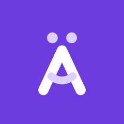

# AchsoKumpel

**Dein Kumpel fürs Deutschlernen**

Turn the German you understand into German you can say.
Free, open source, no ads, no paywall.

**[Try it on the web](https://achsokumpel.deviofy.com/app)** · [achsokumpel.deviofy.com](https://achsokumpel.deviofy.com)

[](LICENSE)


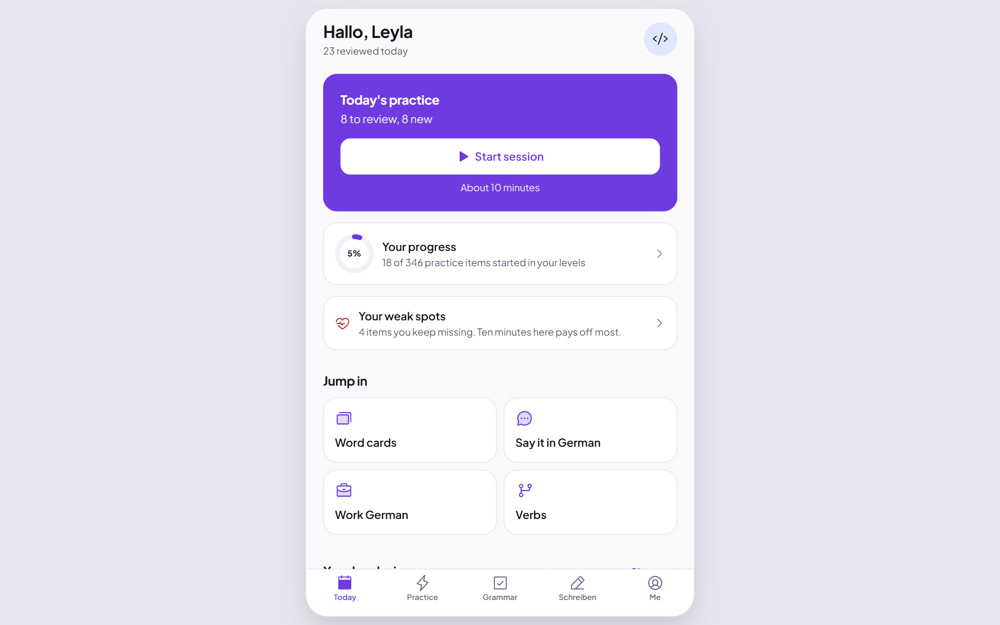

</div>

## Who it is for

You live or work in Germany. You reached B1, B2 or C1 at some point. You understand most of what your colleagues say, but in a stand-up or at the Kneipe the right word arrives three seconds too late. You have no time for a teacher.

AchsoKumpel is built for that gap:

- **Sentences, not word lists.** Every word comes inside a sentence Germans actually say. You build it from memory instead of recognising it.
- **Built around what you forget.** Items you miss come back sooner. Items you know get out of your way.
- **Good enough beats perfect.** No rare exceptions. High-frequency German for work, tech teams and daily life.

## Screenshots

<table>
  <tr>
    <td align="center" width="33%">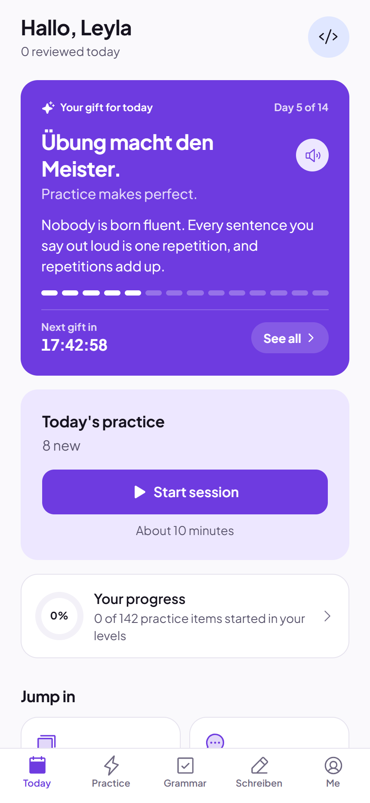<br><sub>Today, with today's gift</sub></td>
    <td align="center" width="33%">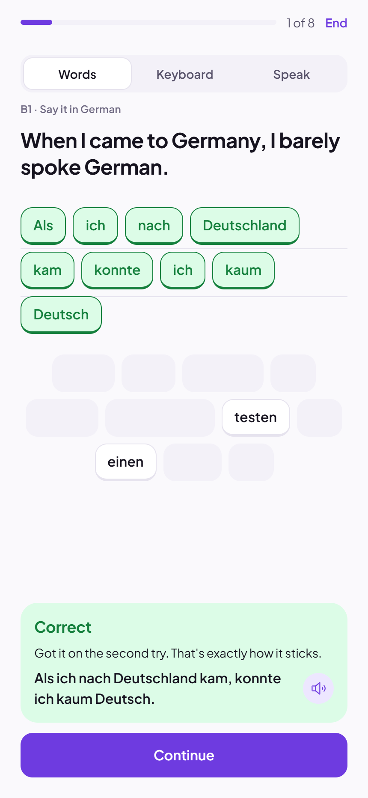<br><sub>Build the sentence from tiles</sub></td>
    <td align="center" width="33%">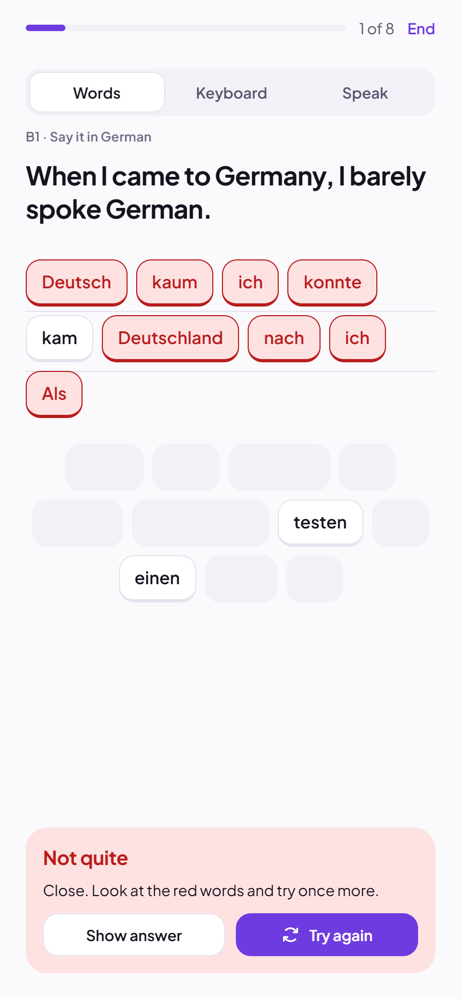<br><sub>Check it, fix it, try again</sub></td>
  </tr>
  <tr>
    <td align="center">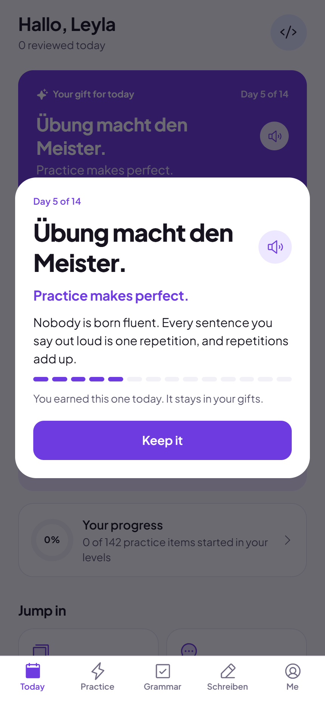<br><sub>A new phrase every morning at 08:00</sub></td>
    <td align="center">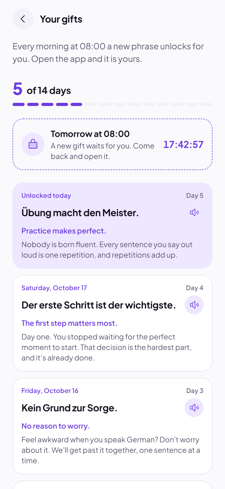<br><sub>All your gifts, and tomorrow's countdown</sub></td>
    <td align="center">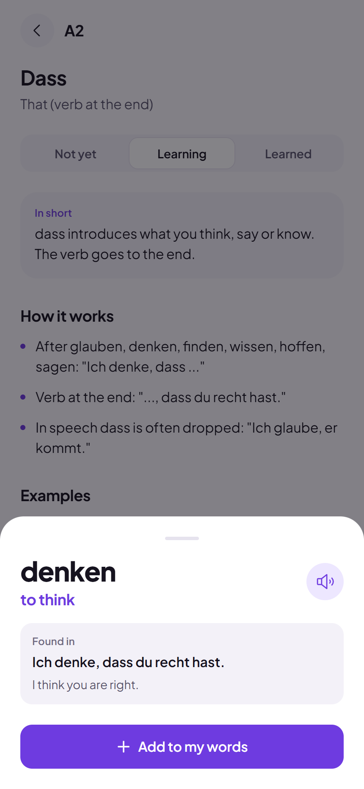<br><sub>Tap any word to save it</sub></td>
  </tr>
  <tr>
    <td align="center">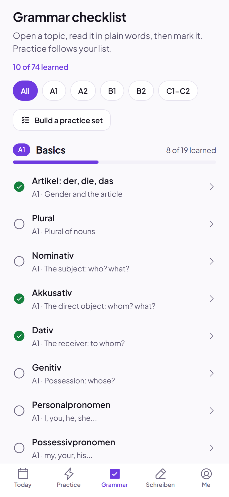<br><sub>74 grammar topics, A1 to C2</sub></td>
    <td align="center">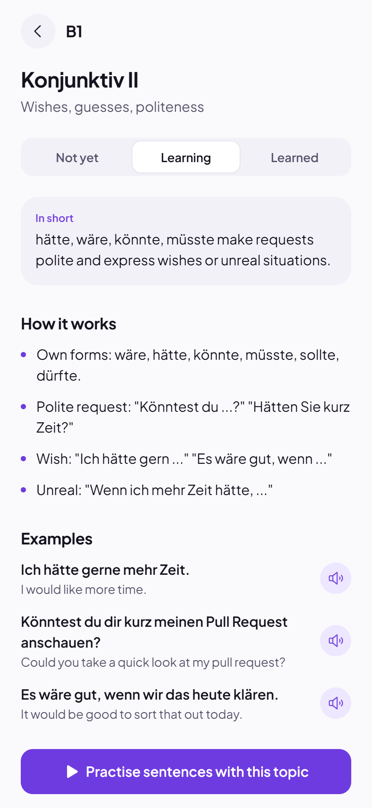<br><sub>Plain-language explanations</sub></td>
    <td align="center">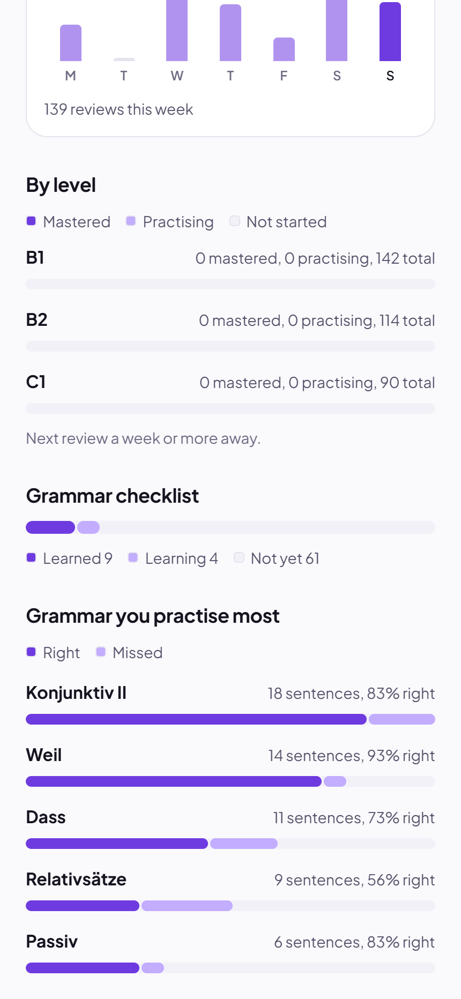<br><sub>The grammar you practise most</sub></td>
  </tr>
  <tr>
    <td align="center">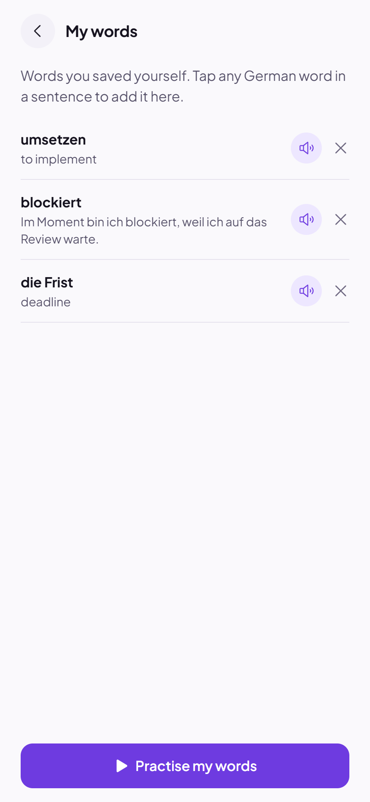<br><sub>My words</sub></td>
    <td align="center">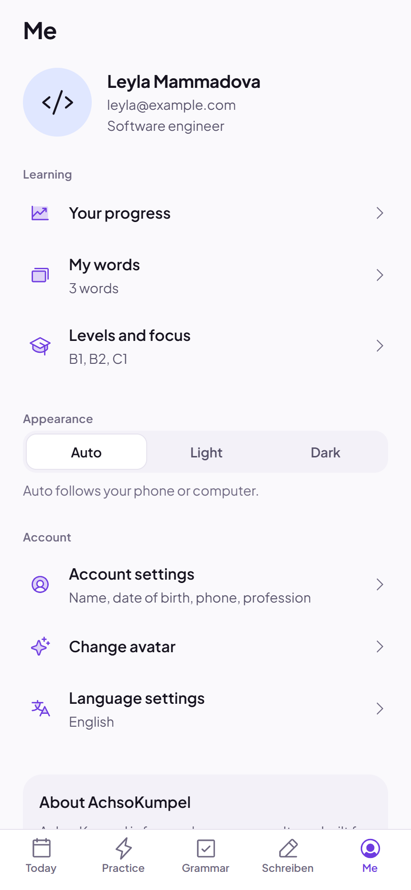<br><sub>Light, dark or auto; settings</sub></td>
    <td align="center">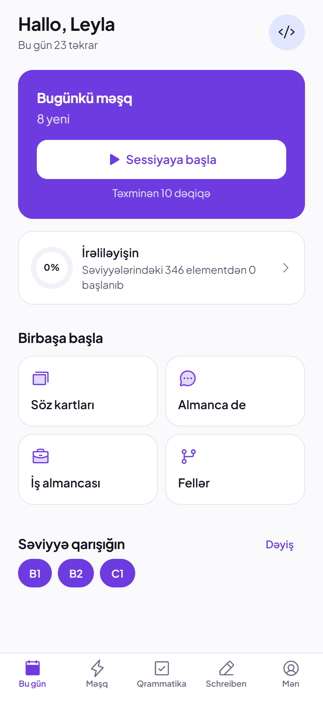<br><sub>Interface in Azerbaijani</sub></td>
  </tr>
  <tr>
    <td align="center">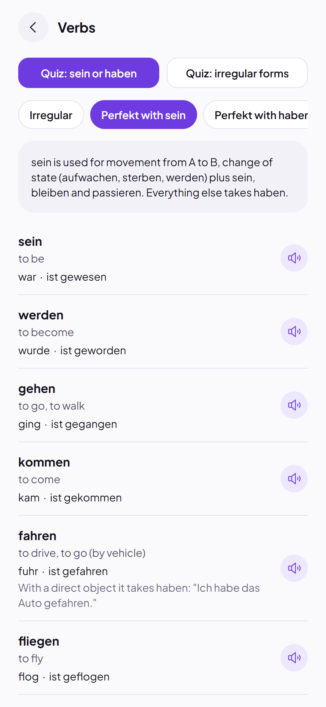<br><sub>Verbs: sein or haben</sub></td>
    <td align="center">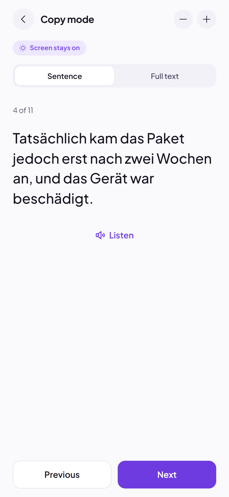<br><sub>Schreiben copy mode</sub></td>
    <td align="center">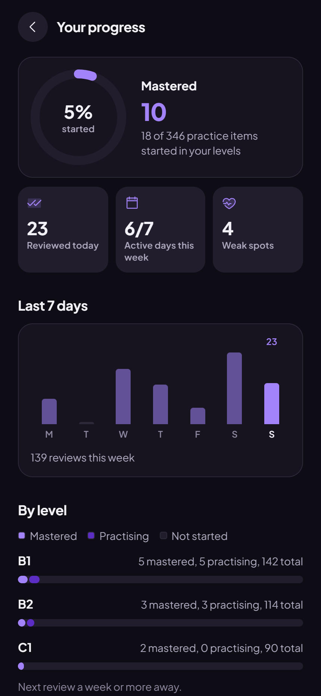<br><sub>Dark mode</sub></td>
  </tr>
</table>

## Brand


The mark is an **Ä whose crossbar is a smile**: German, made friendly. Logo files, the Kumpel Purple palette for light and dark mode, type and icon rules are in [brand/BRAND.md](brand/BRAND.md); all colour values are in [brand/tokens.json](brand/tokens.json).

## What you can do

### Practise speaking from memory

Open **Today** and tap **Start session**. A session takes about ten minutes and mixes the levels you picked. Each item is one of:

| Mode | What you do |
| --- | --- |
| **Say it in German** | You see an English sentence and produce the German in one of three ways, picked with the switch above the card (the app remembers your choice): **Words** (tap word tiles to place them, drag a placed tile to reorder it, tap it to send it back), **Keyboard** (type the sentence) or **Speak** (say it out loud, tap **Show answer**, then rate yourself **Hard**, **Good**, **Easy** or **Again**). |
| **Word cards** | German to English or English to German, with article, plural and an example sentence. |
| **Fill the gap** | You type the missing word in a real sentence. *ae, oe, ue, ss* count as *ä, ö, ü, ß*. |

With **Words** and **Keyboard**, tap **Check**. Words in the wrong place turn red; tap **Try again** to fix them, or **Show answer**. Right on the first try counts as Good, right after a retry as Hard, and showing the answer as Again.

Items you rate **Again** come back at the end of the same session and sooner on the following days. Items you miss repeatedly collect under **Your weak spots** on the Today screen.

The **Practice** tab also has focused sessions: **Work German** (stand-ups, code reviews, blockers, deadlines), **Everyday German**, **From your grammar list** and **My words**.

### Get a small gift every morning

Every morning at 08:00 a new German phrase unlocks, with its translation and a short note for the day. You open it the first time you start the app that day; opening it later in the day is fine. It stays on the **Today** screen as today's gift, with a countdown to the next one. **See all** shows every gift you collected and how many days your journey has. Milestone days (1, 3, 7, 14, 21, 30, 60, 100) get their own phrases.

After each session a short line tells you how it went, in plain words rather than scores.

### Save the words you want to learn

Tap any German word in a practice card, a grammar example or a Schreiben text. A sheet shows the word, its translation if it is in the dictionary (verb forms like *ging* or *denke* are recognised), and the sentence you found it in. **Add to my words** puts it on your own list; **Practice → My words** drills that list.

### See your progress

**Today → Your progress** shows how much of your level mix you have started and mastered, your reviews over the last seven days, a bar per level, and **the grammar you practise most** with how often you got it right. An item counts as mastered once its next review is a week or more away.

### Work through grammar at your own pace

The **Grammar** tab is a checklist of 74 topics in five groups: **Basics** (A1), **Everyday speaking** (A2), **Speaking freely** (B1), **Professional and fluent** (B2) and **Advanced** (C1-C2), from *der, die, das* to *Modalpartikeln*. Each topic has a one-paragraph summary, the rules, spoken examples, common mistakes and prompts to say out loud. You mark it **Not yet**, **Learning** or **Learned**.

Every topic has at least three practice sentences. Tap **Build a practice set**, pick any topics, and you get a session made only of sentences that use them. **From your grammar list** does the same for everything you marked Learning or Learned.

### Get verbs right

**Practice → Verbs** lists irregular and regular verbs, verbs that take *sein* in the Perfekt, verbs that take *haben*, and verbs with fixed prepositions (*warten auf*, *sich kümmern um*). Two quizzes drill *sein or haben* and the Partizip II.

### Write by hand

The **Schreiben** tab has telc-style B1 and B2 letters, work emails (calling in sick, asking for vacation, a status update) and an opinion text. Each task shows the situation, the points to cover, a sample text and useful phrases.

**Copy by hand** shows the sample one sentence at a time in large type, reads it aloud on request, and keeps the screen on so you can copy it onto paper. The tasks follow the telc Schreiben format but are practice material, not official exam tasks.

## Get the app

**Web:** open [achsokumpel.deviofy.com/app](https://achsokumpel.deviofy.com/app). On a phone it fills the screen. On a computer or tablet it opens as one large phone screen with the tab bar at the bottom.

**Android:** build the APK yourself with EAS (free tier is enough):

```bash
npx eas-cli@latest login
npx eas-cli@latest init      # once, links the project to your Expo account
npm run build:apk
```

When the build finishes, EAS shows a download link and a QR code. Open it on the phone and install the APK. Android asks you to allow installs from that source the first time.

### Your account and data

You create an account with an email and a password, without email confirmation, then add your name, date of birth, an optional phone number and profession, an avatar and your level mix.

Under **Me** you can switch between **Light**, **Dark** and **Auto** appearance, edit your details in **Account settings**, and change the app language in **Language settings** (English or Azerbaijani). Translations of the learning content are English for now.

Your account lives on the AchsoKumpel server, so you log in with the same email and password on your phone and on the web. Your progress syncs a few seconds after each change. Without a connection the app keeps working with the copy on your device and sends it the next time it can. If two devices changed your progress, the most recent copy wins.

Builds made without `EXPO_PUBLIC_API_URL` (for example a fork run locally) don't use a server: the account and progress then stay only on that device or browser.

## Run it locally

Requires a current LTS version of Node.js.

```bash
npm install
npx expo start        # press a for Android, w for web, or scan the QR code with Expo Go
```

Locally the app uses device-only accounts. To try it with the server, start the API in a second terminal and point the app at it:

```bash
cd server && npm install && npm run dev                # API on http://localhost:8787
EXPO_PUBLIC_API_URL=http://localhost:8787 npx expo start
```

`npm run check:content` validates the learning content (unique IDs, gap words present in their sentence, grammar references).

## Website and API

The website has two parts: the landing page at `/` (`landing/`) and the web app at `/app`. `npm run build:site` builds both into `site/`, and `npm run preview:site` serves it on http://localhost:8100.

The API in `server/` (Node, SQLite) handles accounts and progress sync. `cd server && npm test` runs its tests.

Both run as Docker containers on the server. To deploy, run this from the project folder in Git Bash:

```bash
./deploy.sh          # website + API
./deploy.sh web      # only the website
./deploy.sh api      # only the API
```

Server layout, the one-time nginx setup and backups are in [docs/DEPLOY.md](docs/DEPLOY.md).

## Releases and update notices

Every copy of the app checks `version.json` on start, every 30 minutes, and when it comes back to the foreground:

- **A newer version exists:** a banner offers **Reload** (web) or **Download** (Android).
- **This version is too old for the saved data:** a full-screen notice asks the learner to update before continuing.
- **After updating:** a **What's new** sheet lists the changes since the last version this device saw.

To ship a release:

1. Raise `expo.version` in `app.json`. If older versions can no longer handle the saved progress or content, also raise `expo.extra.minSupportedVersion`.
2. Add an entry at the top of `src/data/changelog.js`.
3. If the shape of saved progress changed, add a migration step in `src/features/progress/migrations.js`.
4. Run `npm run check:content` and `npm run build:apk`.
5. Put the APK download link in `expo.extra.apkUrl` and run `./deploy.sh`.

Production builds read `EXPO_PUBLIC_API_URL` and `EXPO_PUBLIC_VERSION_URL` from `.env.production`. Both values end up in the app bundle, so never put secrets there.

## Add a language

The interface and the translations of learning content are separate:

- **Interface:** English (`en.js`) and Azerbaijani (`az.js`) are included. To add a language, copy `src/i18n/locales/en.js`, translate the values and register it in `src/i18n/index.js`. `npm run check:i18n` lists missing keys; missing keys fall back to English.
- **Learning content:** every German entry stores translations by language code, `tr: { en: '...' }`. Add `az: '...'` next to `en` in `src/data/*` and set `ready: true` for `az` in `src/i18n/content.js`.

## Contributing

Content is the most valuable contribution: natural sentences people really say, clearer grammar explanations, translations. Keep sentences short and frequent. IDs in `src/data` are stored in learners' progress, so never rename them; add new sentences at the end of their level.

Run `npm run check:content` before you open a pull request.

## Project structure

```
src/
  app/            screens (Expo Router): tabs, registration steps, practice, grammar, writing
  components/     shared UI and the large-screen frame
  screens/        screen bodies shared by several routes
  features/       auth, progress and sync, spaced repetition, practice sessions, daily gifts, speech,
                  update checks, AI feedback contract (see docs/AI.md)
  data/           words, sentences, grammar, verbs, writing tasks, changelog
  i18n/           interface strings and content-language helpers
  theme/          brand colours, spacing, type (light and dark)
server/           API: accounts and progress sync (Node, SQLite, Docker)
landing/          landing page served at /
deploy/           Docker and nginx files for the server (see docs/DEPLOY.md)
brand/            logo files, brand guide, colour tokens, brand board
scripts/          content and translation checks, version manifest, site build
```

## Planned

- Speech feedback: record a sentence, get corrections and a more natural version.
- Handwriting feedback: photograph a letter you wrote, get corrections and better word choices.
- Azerbaijani translations of the learning content.

The interface both feedback features plug into is described in [docs/AI.md](docs/AI.md).

## License

[MIT](LICENSE)
