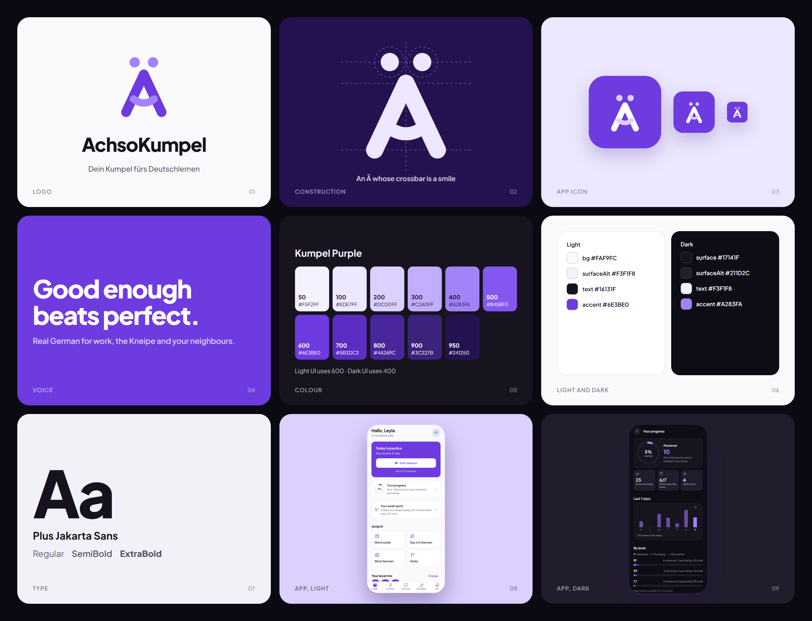

# AchsoKumpel brand guide

## The idea

**Ach so!** is what Germans say when something finally clicks. **Kumpel** is a buddy. The brand is a friendly guide that helps you reach that moment in real conversations.

## Logo

The mark is an **Ä whose crossbar is a smile**. The umlaut makes it unmistakably German, and the smile makes it a Kumpel rather than a textbook. The smile reaches slightly past the legs, like arms around a friend.

| File | Use |
| --- | --- |
| `logo/symbol-duo.svg` | Default on light backgrounds (purple + lilac) |
| `logo/symbol-dark-duo.svg` | Default on dark backgrounds |
| `logo/symbol.svg` | One-colour purple |
| `logo/symbol-black.svg`, `logo/symbol-white.svg` | One-colour print, embossing, photos |
| `logo/app-icon.svg` | App icon and favicon source (white mark on a purple tile) |
| `logo/android-*.svg` | Android adaptive icon layers |

`concepts/` holds the two alternative directions (Speech ä, Kumpel bubble) that were explored.

**Clear space:** keep one umlaut-dot diameter of empty space around the mark on every side.
**Minimum size:** 16 px on screen. Below 24 px, use the one-colour version.

Do not:
- rotate, stretch or outline the mark
- put the duo-tone mark on a busy photo (use one-colour white)
- recolour the smile and legs in two unrelated colours
- set the wordmark in another typeface

## Colour

One brand hue, **Kumpel Purple**, plus violet-tinted neutrals. The purple is the action colour: primary buttons, the active tab, progress. Everything else is neutral. Red, green and amber are reserved for wrong, right and warning.

| Token | Light | Dark | Role |
| --- | --- | --- | --- |
| accent | `#6E3BE0` (purple 600) | `#A283FA` (purple 400) | Buttons, active states, data |
| accentSoft | `#EDE7FF` | `#2A1F47` | Tinted backgrounds, icon chips |
| accentMuted | `#C2ADFF` | `#5B2DC2` | Second data series ("practising") |
| bg | `#FAF9FC` | `#0E0C14` | Page |
| surface | `#FFFFFF` | `#17141F` | Cards |
| text | `#16131F` | `#F3F1F8` | Body text |
| textMuted | `#57526A` | `#ADA7BD` | Secondary text |

All text pairs meet WCAG AA (4.5:1). Primary button text on purple: 6.2:1 (light), 6.4:1 (dark).

The full 50 to 950 purple scale and every token are in [`tokens.json`](tokens.json); the app reads the same values from `src/theme/index.js`.

## Type

**Plus Jakarta Sans** (SIL Open Font License), weights 400 to 800. Headlines in 700 to 800 with slightly tight tracking, body in 400, labels in 600. No second typeface.

## Icons

**Phosphor**, one family across the app. Regular weight by default, **fill** for the active tab and status, **duotone** for feature tiles. Screens use semantic names (`listen`, `weak`) through `src/components/icon.js`, so the set can be swapped in one place.

## Charts

Progress is shown in a single purple hue: strong purple for done or mastered, muted purple for in progress, a neutral track for not started. Every value is also printed as text, so nothing depends on telling two purples apart.

## Voice

Plain, warm, direct. Short sentences. No exclamation marks in the interface, no em dashes, no hype words. Example: "Good enough beats perfect."
